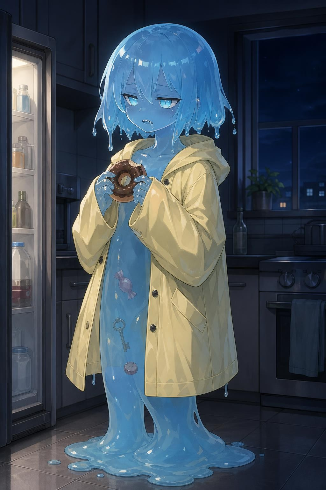
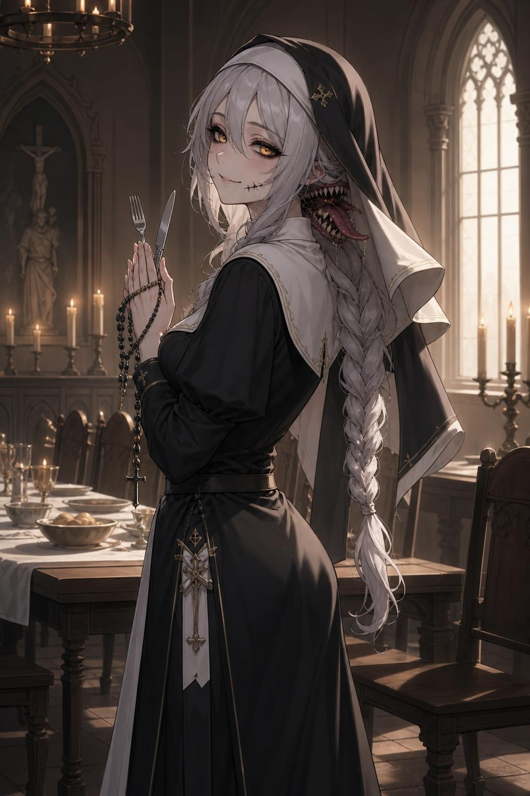
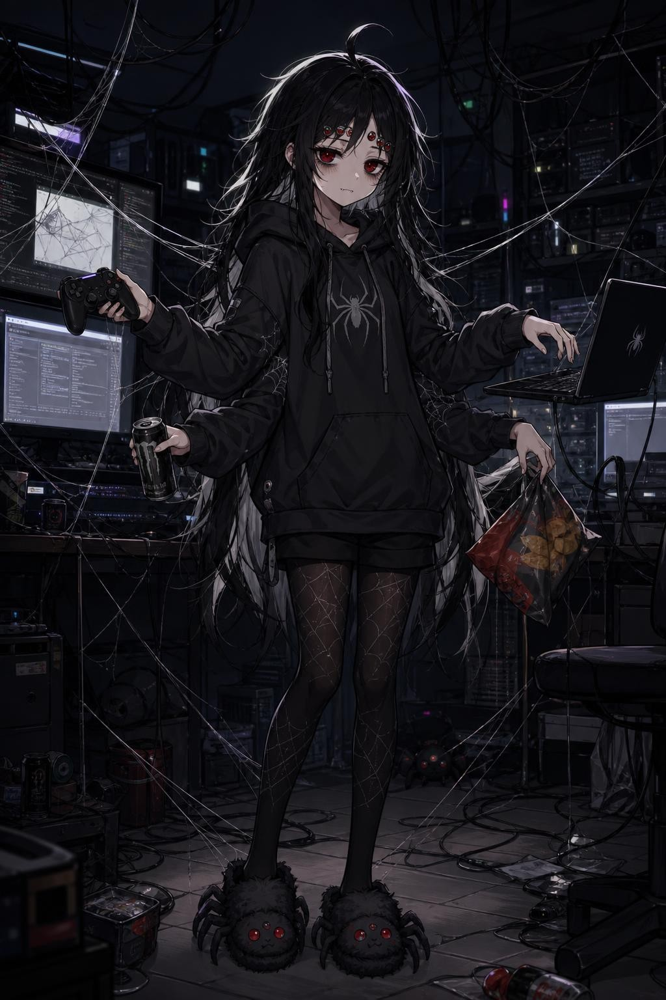
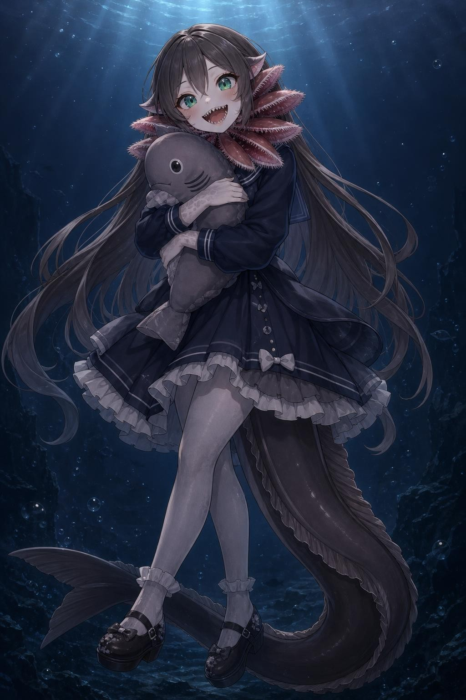
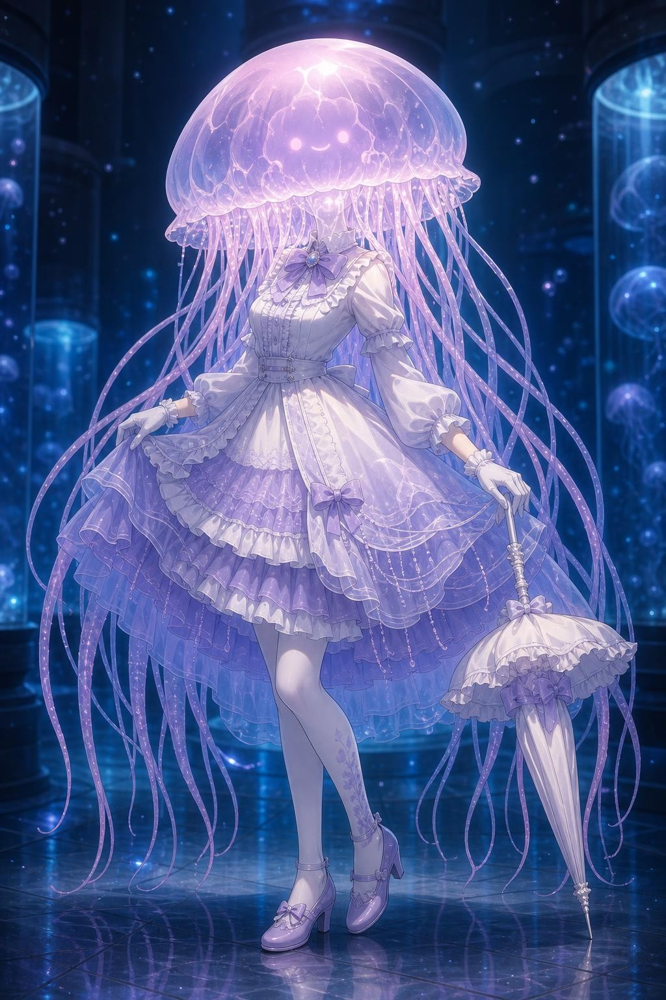
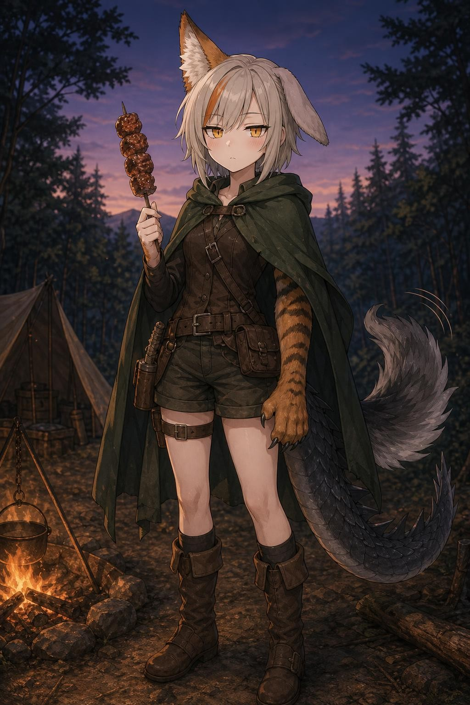
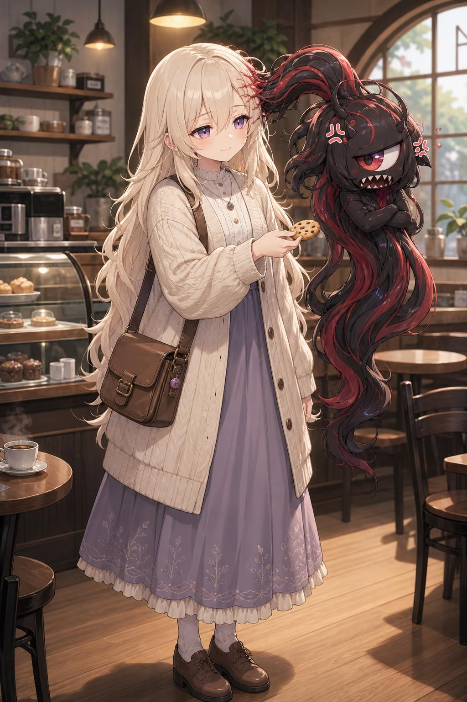
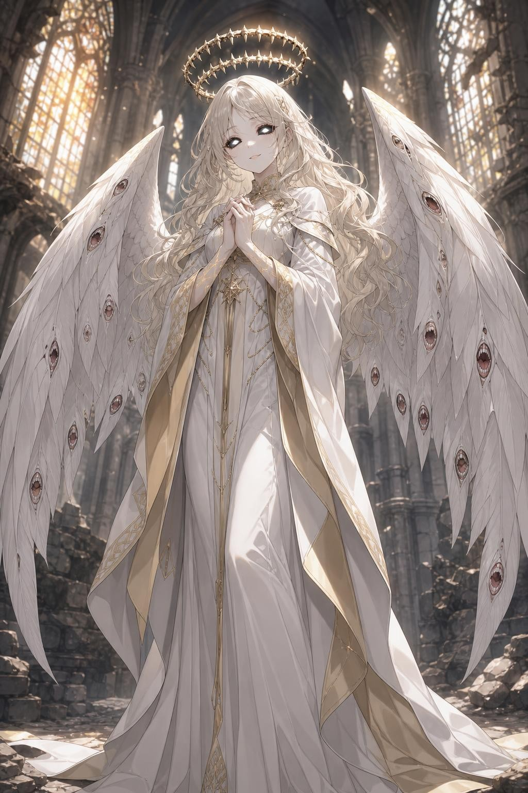

# 捕食適応種族 コンセプト集 Vol.2：オタク受け特化編

[癖カタログ](jingai-heki.md)の要素を、1キャラに2〜4個ずつ積み増して作った8種族。
「どの癖を盛ったか」を各キャラに書いてある。

---

## V2-01. ハミィ（Hammy）：擬態が下手なスライム

- **盛った癖：** 半透明の体／胃の中が見える／人間のふりが下手／ギザ歯／ジト目
- **生態：** 何でも包み込んで溶かすゲル状の捕食種。人間の形を保つのが苦手で、気を抜くと足元から溶ける。
- **外見：** ソーダ色の透き通った体の中に、飴玉、鍵、ボタン、王冠がぷかぷか浮いている。髪も同じゼリーで、毛先から垂れる。ぶかぶかの黄色いレインコート。
- **性格：** ダウナーな甘えん坊。つまみ食いの常習犯で、証拠が体の中に見えているのに「たべてない」と言い張る。
- **セリフ：** 「たべてない。……たべた」
- **RimWorldでの遊び方：** 倉庫のアイテムを勝手に「保管」する。体の中から取り出せば返ってくる。

## V2-02. グラトニカ（Gluttonica）：本音の口を持つシスター

- **盛った癖：** 第二の口／白目黒目／見た目は神聖、中身は異形／「いただきます」の重み
- **生態：** 首の後ろにもう一つの口がある捕食種。表の口は祈りを、裏の口は本音を話す。
- **外見：** 銀髪のゆるい三つ編みに修道服。黒い白目に金の瞳で、たれ目。ベールの下、うなじにギザ歯の口がにやついている。口元に黒いひびの模様。
- **性格：** 表は慈愛に満ちたシスター。裏の口が「おなかすいた」「あいつ嫌い」と全部ばらしてしまう。
- **セリフ：** 「主よ、今日の糧に感謝を」（裏の口：「量すくなっ」）
- **RimWorldでの遊び方：** 葬儀の代わりに「聖餐」で死者を弔い、ムードとバフを得る。

## V2-03. ロクメ（Rokume）：六つ目の引きこもり蜘蛛

- **盛った癖：** 多眼／多腕／ジト目＋隈（全部の目に）／ダウナー
- **生態：** 糸で獲物を捕らえ、消化液で溶かして吸う蜘蛛型の捕食種。巣はネットワークと一体化している。
- **外見：** 白メッシュ入りのぼさぼさの黒髪にアホ毛。メインの目2つに、おでこの小さな目が4つ。全部の目に濃い隈。4本の腕で、ゲーム、エナドリ、キーボード、お菓子を同時にこなす。
- **性格：** 引きこもりのハッカー。目が6つあるのに、人と目を合わせられない。
- **セリフ：** 「……見てない。六個とも見てない」
- **RimWorldでの遊び方：** 研究と通信が得意。糸の罠で襲撃者を拘束できる。

## V2-04. フリル（Frill）：ラブカの懐き捕食者

- **盛った癖：** 捕食者なのに懐く／ギザ歯（三叉の歯がずらり）／尻尾で感情がバレる／生きた化石
- **生態：** 深海の「生きた化石」ラブカがモチーフの古代種。三叉の歯で獲物を絶対に逃がさない。
- **外見：** 首のフリル襟は、6対あるピンクのエラ。大きな翠の瞳で、きらきらした懐き顔。笑うと小さな三叉の歯がずらり。スカートの下からウナギのような尾が出ていて、ぶんぶん振っている。
- **性格：** 一度懐いたら離れない、子犬系。愛情表現が甘噛み（ただし歯が三叉）。
- **セリフ：** 「すき。だいすき。……ちょっとだけかじっていい？」
- **RimWorldでの遊び方：** 絆を結んだ入植者のそばにいると強くなる。離れると寂しくてムード低下。

## V2-05. ポリプ（Polyp）：クラゲ頭のお嬢様

- **盛った癖：** 異形頭／発光で感情が出る／人外度ガチ勢向け
- **生態：** 頭部がまるごとクラゲの傘になっている種族。触手の毒で獲物を痺れさせて食べる。
- **外見：** 半透明のピンクとラベンダーの傘の中に、発光する点で描かれた顔（点の目と小さな笑み）が浮かぶ。膝まで垂れる光る触手が髪の役目。クラゲの層のようなロリィタドレス。
- **性格：** 優雅なお嬢様。表情は発光パターンでしか分からず、照れると全体がピンクに光る。
- **セリフ：** 「ごきげんよう。……あら、光ってました？」
- **RimWorldでの遊び方：** 人外度が最も高い枠。触手の麻痺攻撃と、暗闇での光源役。

## V2-06. ヌイ（Nui）：無表情なキメラ

- **盛った癖：** 無表情なのに耳と尻尾が正直／食べた獣のパーツが生える／継ぎ接ぎ
- **生態：** 食べた獣の部位が体に生えてくる、鵺（ぬえ）のような合成獣。
- **外見：** 左は立ったキツネ耳、右は垂れたウサギ耳。後ろに竜の尾と狼の尾。片腕だけ虎の毛皮と爪。灰金色の短髪にオレンジのメッシュ。琥珀の縦長の瞳で、表情はずっと「無」。なのに頬が赤い。
- **性格：** クールで無口。でも耳と尻尾が全部ばらしている。
- **セリフ：** 「別に、うれしくない」（尻尾が二本ともぶんぶん）
- **RimWorldでの遊び方：** 倒して食べた動物の部位が生えて能力が増える。Vol.1 の「吸収」をもっとも素直に見せられる種族。

## V2-07. リリ＆ルル（Lili & Lulu）：髪に住む相棒

- **盛った癖：** 一体二心／ツンデレの寄生体／おっとりの宿主
- **生態：** 宿主の少女と、その髪に寄生した生物の共生体。捕食はルル（寄生体）の担当。
- **外見：** リリはクリーム色のロングヘアで、ラベンダーのたれ目のおっとり系。右のツインテールだけが黒と深紅の生き物（ルル）で、大きな単眼とギザ歯の口がある。こめかみに、つながっている部分の赤い血管模様。
- **性格：** リリは天然、ルルはツンデレ。ルルはリリを守るためなら何でも食べる。
- **セリフ：** リリ「ルルちゃん、クッキーいる？」 ルル「いらねーし！……一個だけな」
- **RimWorldでの遊び方：** 1人で2人分。ルルが独立した「人格」として、別の特性を持つ。

## V2-08. エンジェラ（Angela）：天使の皮をかぶった捕食者

- **盛った癖：** 見た目は神聖、中身は異形／白目黒目／よく見ると怖い細部
- **生態：** 天使の姿で獲物を引き寄せる擬態捕食種。光輪は歯の輪、羽根の先は目と口。
- **外見：** プラチナブロンドの波打つ髪に、白と金のローブ、大きな白い翼。でも光輪をよく見ると鋭い歯が並んだ輪で、翼の縁の羽根の先には小さな目と口がある。黒い白目に光る白い瞳。手の甲に金の血管模様。
- **性格：** 慈愛そのものの微笑み。でも慈愛と食欲を区別していない。
- **セリフ：** 「怖がらないで。あなたは、わたしの一部になるだけ」
- **RimWorldでの遊び方：** 敵の士気を下げる「啓示」と、入植者を癒やす「祝福」が同じ能力の表と裏。
