# 捕食適応種族 コンセプト集 Vol.1

RimWorld 追加種族MOD用の構想メモ。共通テーマは「捕食・吸収・適応・進化」。
画像は `images/` に置いた gpt-image-2 によるラフなコンセプトアート。

各種族の項目：
- **生息・起源**：どこで生まれたか
- **捕食と進化**：何を食べ、何を得て、どう変わるか
- **外見**：髪、目、隈や模様、肌、服装
- **性格**
- **RimWorldでの遊び方**：ゲームに入れたときの面白さ

---

## 01. ヴェルミナ（Vermina）：鯨骨の娘
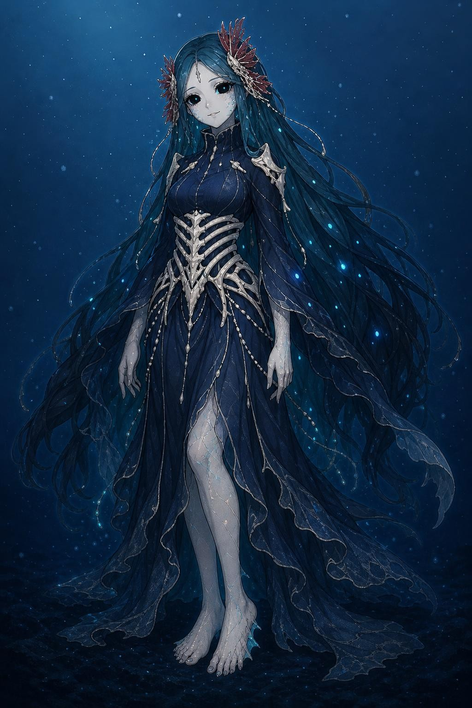

- **生息・起源：** 深海。海底に沈んだ巨大生物の死骸（鯨骨）に群がる生態系から生まれた。「落ちてくる死」を待つ種族。
- **捕食と進化：** 死骸を時間をかけて分解し、骨格を取り込んで自分の外骨格にする。食べた生物が大きいほど、骨のコルセットが立派になる。
- **外見：** 深い青緑から黒へのロングヘアに、ハダカイワシのような発光点。髪飾りは赤いチューブワーム。肌は骨のような白に真珠の光沢。白目が黒く、虹彩は細いシアンの輪。
- **性格：** 静かで気長。死を怖がらず、弔いと食事の区別がない。
- **RimWorldでの遊び方：** 死体を「埋葬」する代わりに「還す」ことで強化。湿地や海岸のマップで真価を発揮する。

## 02. ノクティル（Noctile）：星を食む虚空の子
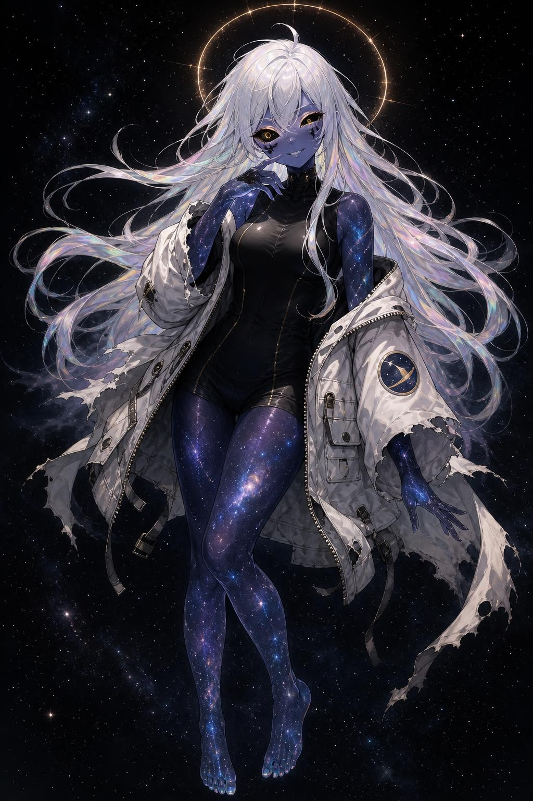

- **生息・起源：** 宇宙空間。漂流する宇宙船の残骸に付着して運ばれてきた、真空に適応した生命。
- **捕食と進化：** 星の光や放射線を食べる。体の内側に「食べた星空」が溜まっていき、溜まるほど体が透けて夜空のようになる。
- **外見：** 無重力のように浮かぶ白髪に、プリズムのような虹色の縁取り。肌は藍色の半透明で、内側に星雲が光る。瞳は日食のような黒地に金のコロナ。目の下に三日月形の隈。
- **性格：** 好奇心旺盛でいたずら好き。重力が珍しくて、よく物を落として遊ぶ。
- **RimWorldでの遊び方：** 太陽フレアや宇宙線イベントでむしろ回復する。日光が苦手な種族と対になる設計。

## 03. フィザリア（Physaria）：地底の粘菌知性
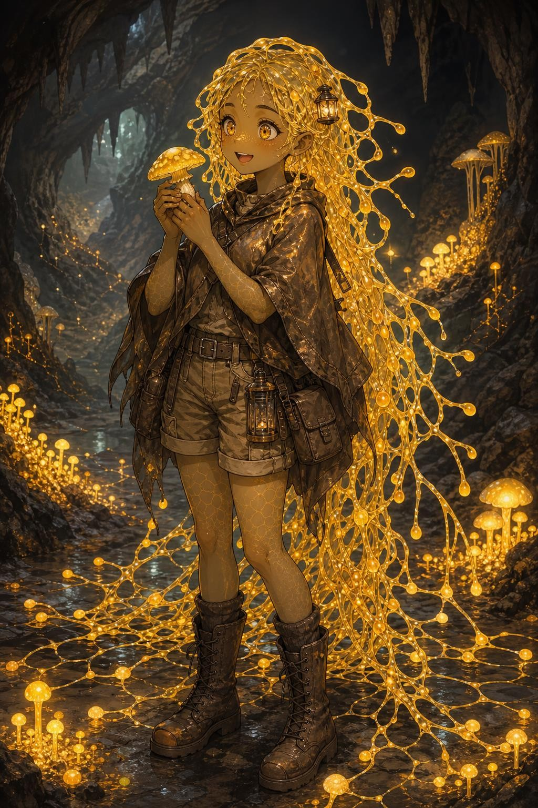

- **生息・起源：** 地底洞窟。迷路を最短で解く粘菌の群体が、知性を持つまで育ったもの。
- **捕食と進化：** 獲物を網状の体で包み込んで溶かす。食べた情報で「頭の中の地図」が広がり、探索力と学習速度が上がる。
- **外見：** 粘菌の管のように枝分かれした蜂蜜色の半透明の髪で、毛先は足元まで網のように広がる。肌はオリーブ色に細い網目模様。琥珀の瞳の中で、瞳孔が網目状になっている。
- **性格：** 明るいパズル好き。「最短ルート見つけた！」が口癖。
- **RimWorldでの遊び方：** 研究と採掘が得意。山岳マップや洞窟拠点に最適。複数人いると網でつながってボーナスが出る。

## 04. ロット07（Lot-07）：培養槽の失敗作
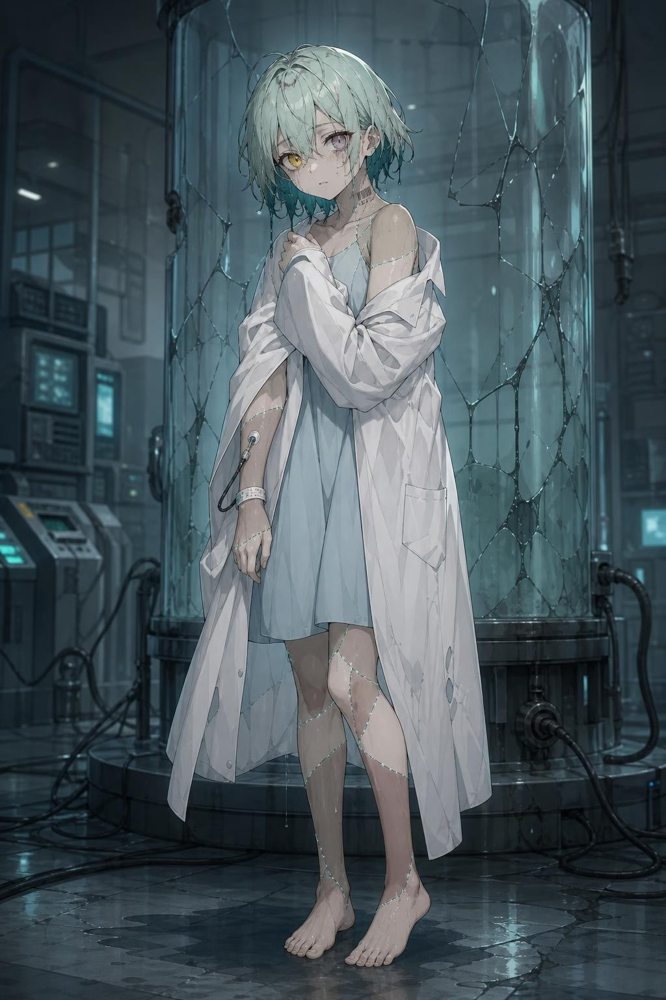

- **生息・起源：** 放棄された研究所の培養槽。生体兵器計画の「失敗作」として廃棄を待つ間に、研究所のほうが滅んだ。
- **捕食と進化：** 他者の組織を「移植」して取り込む。縫い目が増えるたびに能力も増えるが、拒絶反応のリスクがある。
- **外見：** 濡れたミントグリーンの短髪。左目はピンク、右目は金のオッドアイで、どちらも縦長の瞳孔。濃い隈。肌は色の違うパッチワークで、ターコイズに光る縫合線でつながっている。首にバーコードと「07」。
- **性格：** 人見知りで警戒心が強い。白衣の袖をずっと握っている。
- **RimWorldでの遊び方：** 手術で他の入植者や動物の部位を移植するほど強くなる。医療と倫理で悩ませる枠。

## 05. ヘリクス（Helix）：知を喰らう深淵の司書
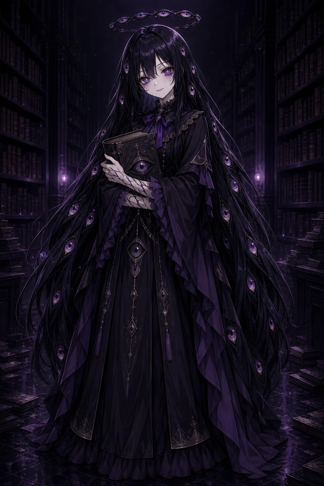

- **生息・起源：** 深淵、あるいは異次元。「見る」ことで相手の知識と記憶を食べる存在。
- **捕食と進化：** 視線で捕食する。読んだ本や見た人の技能を吸い取り、髪の中の目が増えていく。
- **外見：** 紫がかった漆黒のロングヘアで、髪の中に紫の瞳がいくつも開いている。頭上には閉じた目が並んだ光輪。瞳は星形の瞳孔で、眠たげ。濃い隈。指先から黒い血管模様が這い上がる。
- **性格：** 眠そうで穏やか。でもときどき、言ってはいけないことを知っている。
- **RimWorldでの遊び方：** 本や捕虜から技能を吸収する。Anomaly DLC と組み合わせると最高に噛み合う。

## 06. カルデリア（Calderia）：鉄を喰う火山の娘
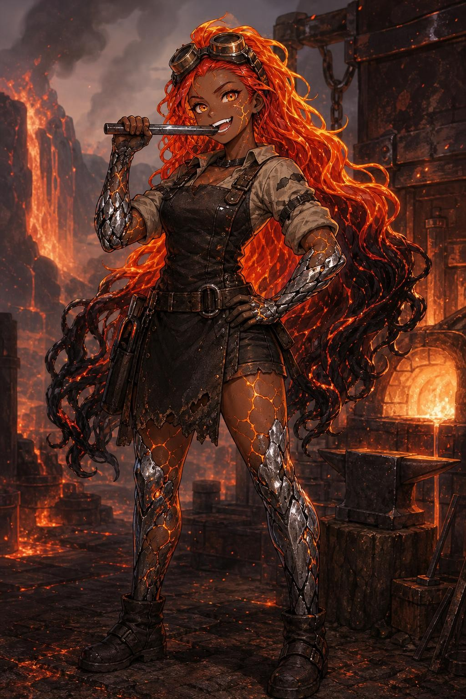

- **生息・起源：** 火山の熱水噴出孔。光のない世界で、鉱物と化学反応からエネルギーを得る生物。
- **捕食と進化：** 金属と鉱物を食べる。食べた金属がそのまま腕や脚の装甲として生えてくる（鋼、銀、プラスチール、ウラン…）。
- **外見：** 根元はオレンジ、毛先は冷えて黒曜石になる溶岩のような髪。褐色の肌にマグマ色のひび模様。瞳は溶けた金。八重歯。
- **性格：** 豪快な姉御肌。鍛冶仕事が大好き。
- **RimWorldでの遊び方：** 拠点の鋼材を勝手につまみ食いする。何を食べさせたかで装甲の性能が変わる「育成」が楽しい。

## 07. クリオナ（Cryona）：永久凍土の眠り姫
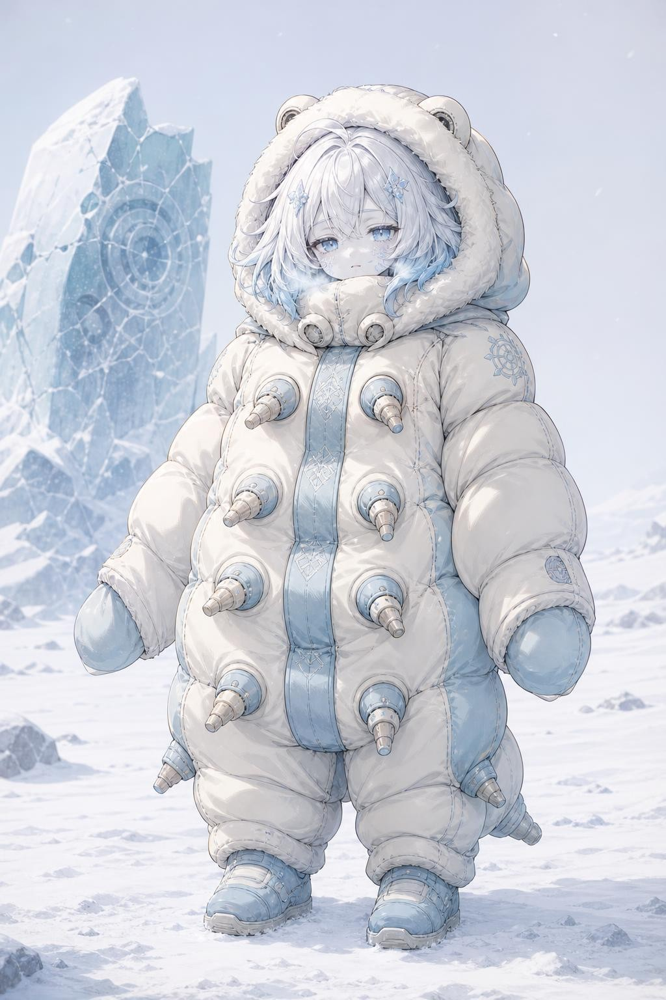

- **生息・起源：** 永久凍土の氷の中で数万年眠っていた古代の極限生物。クマムシがモチーフ。
- **捕食と進化：** 獲物を凍らせて、体内に「保存」する。危機に陥ると乾眠（クリプトビオシス）状態になり、ほぼ不死身になる。
- **外見：** ふわふわの霜色の髪に氷の結晶。肌は青白い。瞳は氷の層のような同心円の水色で、いつも半目。頬に霜の模様。クマムシのようなもこもこの節つきコートを着ている。
- **性格：** ずっと眠い、のんびり屋。でもしぶとさは全種族中最強。
- **RimWorldでの遊び方：** 致命傷を受けると乾眠して倒れ、後で復活する。極寒マップのお守り役。

## 08. ネペンテア（Nepenthea）：甘い香りの食虫花
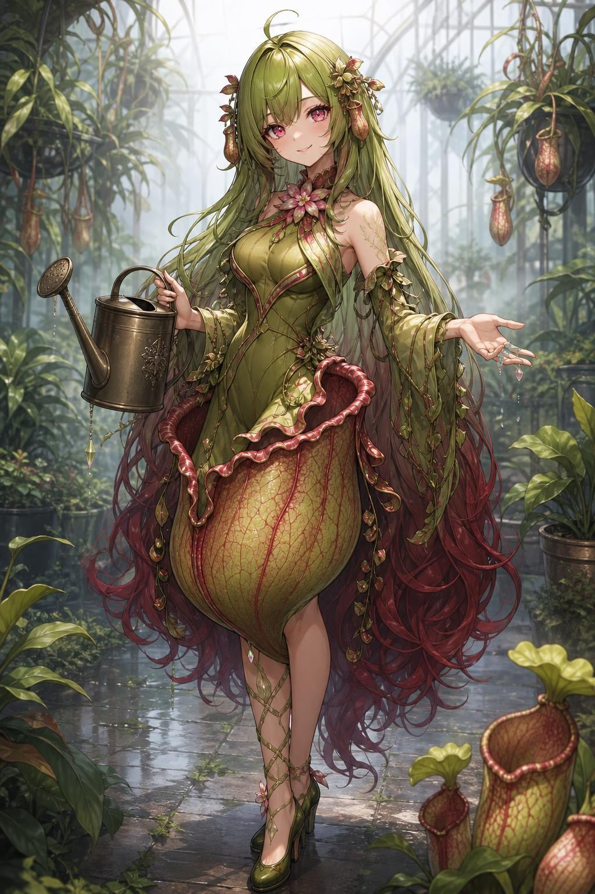

- **生息・起源：** 熱帯のジャングル。ウツボカズラ（食虫植物）から進化した植物種族。
- **捕食と進化：** 甘い香りで獲物を誘い、壺状の器官で溶かして吸収する。光合成もできるので、半分植物。
- **外見：** 若葉の緑からワインレッドへのグラデーションの髪に、蓋つきの壺の髪飾り。肩に葉脈の模様。瞳はピンクで、瞳孔が花の形。指先に蜜のしずく。スカートがウツボカズラの形をしている。
- **性格：** 優しくて世話焼き。でも笑顔の奥がちょっと怖い。
- **RimWorldでの遊び方：** 香りで敵や動物をおびき寄せる罠役。日光と水で空腹がやわらぐ。

## 09. フェロファージ（Ferrophage）：機械狩りのナノ体
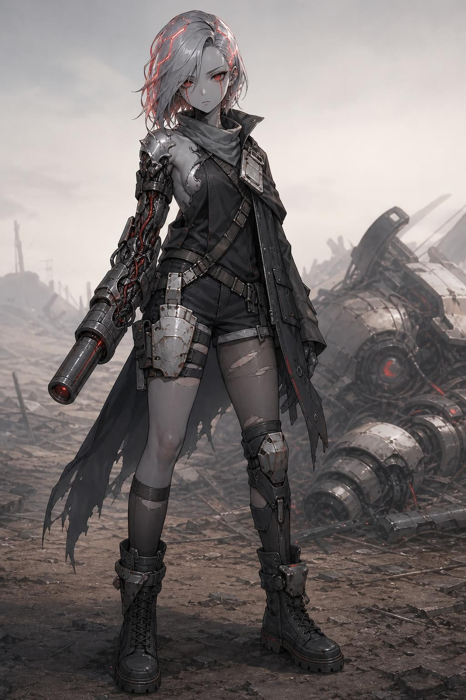

- **生息・起源：** 古代の戦争で使われた対メカノイド用ナノマシン群が、生体と融合して自我を持った。
- **捕食と進化：** メカノイドを狩って食べ、その部品と武装を自分の体に取り込む。
- **外見：** 赤い回路の線が走る、左右非対称の銀髪。赤い瞳にLEDのリング状の瞳孔。目の下に涙のような赤い回路模様。右腕はメカノイドから奪った装甲とキャノンで、肩のところで液体金属を境に生身とつながっている。
- **性格：** 無口でクール。メカノイドを見ると目の色が変わる。
- **RimWorldでの遊び方：** メカノイドの襲撃が「ごちそう」になる。倒した機体の種類で武装が変わる。

## 10. ミメティカ（Mimetica）：鏡写しの擬態種
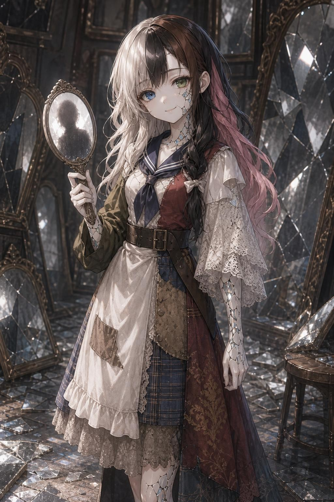

- **生息・起源：** 不明。誰も「本当の姿」を見たことがない。
- **捕食と進化：** 食べた相手の姿と技能を写し取る。いまの少女の姿は、これまで食べた人たちの「いいところ」の寄せ集め。
- **外見：** プラチナ、栗色、黒、ピンクの、まったく違う人の髪をつないだような髪。青と緑のオッドアイに鏡の光沢。陶器のような肌にひびがあり、下から鏡の破片がのぞく。服も色々な人の服のパッチワーク。手鏡には顔のない影が映っている。
- **性格：** 優しいけど、自分が誰なのか分からなくて寂しがっている。
- **RimWorldでの遊び方：** 死んだ入植者の技能を引き継げる。その代わり、取り込むたびに性格（特性）が少しずつ入れ替わる。

## 11. ルナモス（Lunamoth）：月夜に羽化する蛾の娘
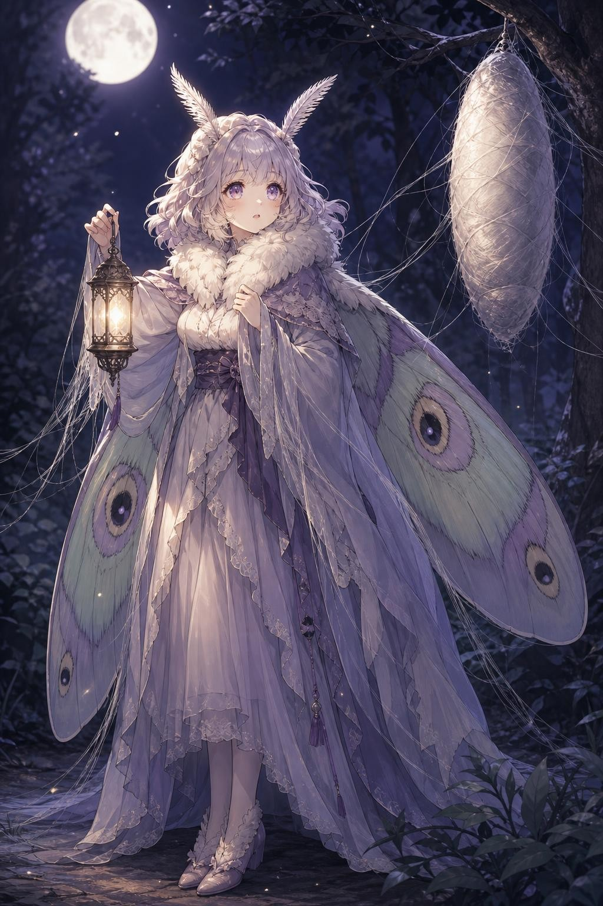

- **生息・起源：** 夜の森。蛾のように完全変態する種族。
- **捕食と進化：** 十分に食べると繭にこもり、羽化して新しい形態になる。羽化のたびに羽と能力が変わる。
- **外見：** ふわふわの薄紫とクリーム色の髪に、羽毛のような触角。首元にもこもこの白い襟毛。瞳は星の光が入った大きなプラム色。背中に目玉模様のある淡い緑と紫の羽。袖から繭の糸が垂れている。
- **性格：** 恥ずかしがり屋の夢見がち。明かりについ吸い寄せられてしまう。
- **RimWorldでの遊び方：** 進化するたびに数日間「繭」になって動けなくなる。守り抜くと強くなって出てくる。

## 12. ハリタ（Halita）：桃色塩湖の結晶種
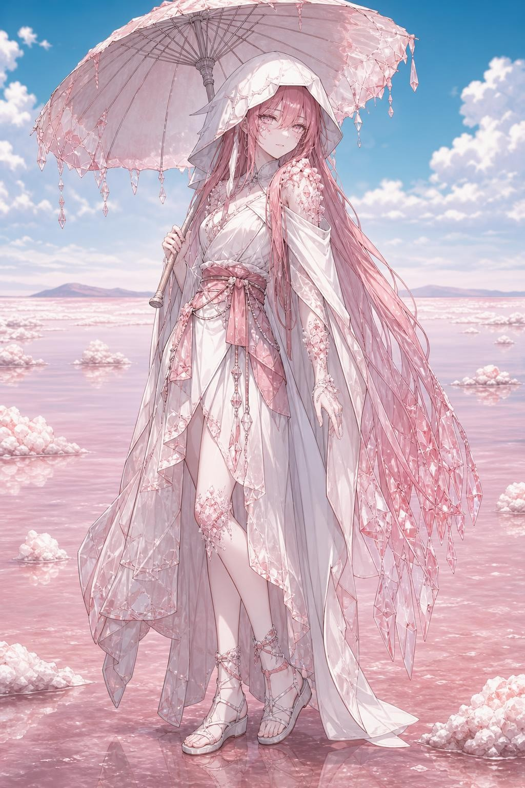

- **生息・起源：** 砂漠の塩湖。塩湖をピンクに染める好塩性の古細菌がモチーフ。
- **捕食と進化：** 獲物の水分を吸い尽くして干からびさせ、そのミネラルで体に塩の結晶を育てる。結晶が増えるほど硬くなる。
- **外見：** 毛先がピンクの岩塩の結晶になった、まっすぐなローズピンクの髪。肩、肘、膝に塩の結晶の群れ。瞳は淡いピンクで、瞳孔が立方体の結晶。目の周りに塩の結晶模様。白いフードつきの砂漠装束に日傘。
- **性格：** 物静かで少し高飛車。水を大事にしない人が嫌い。
- **RimWorldでの遊び方：** 砂漠や乾燥マップ向け。水分（食事）が少なくても生きられる代わりに、雨と湿地が大の苦手。
